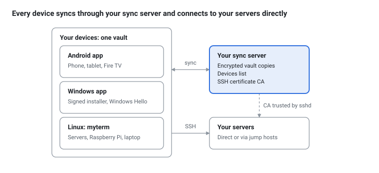
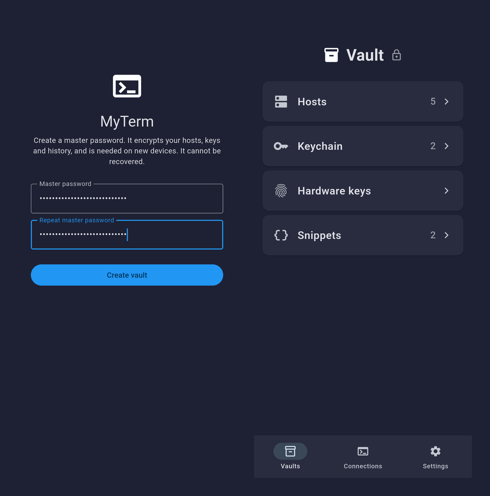
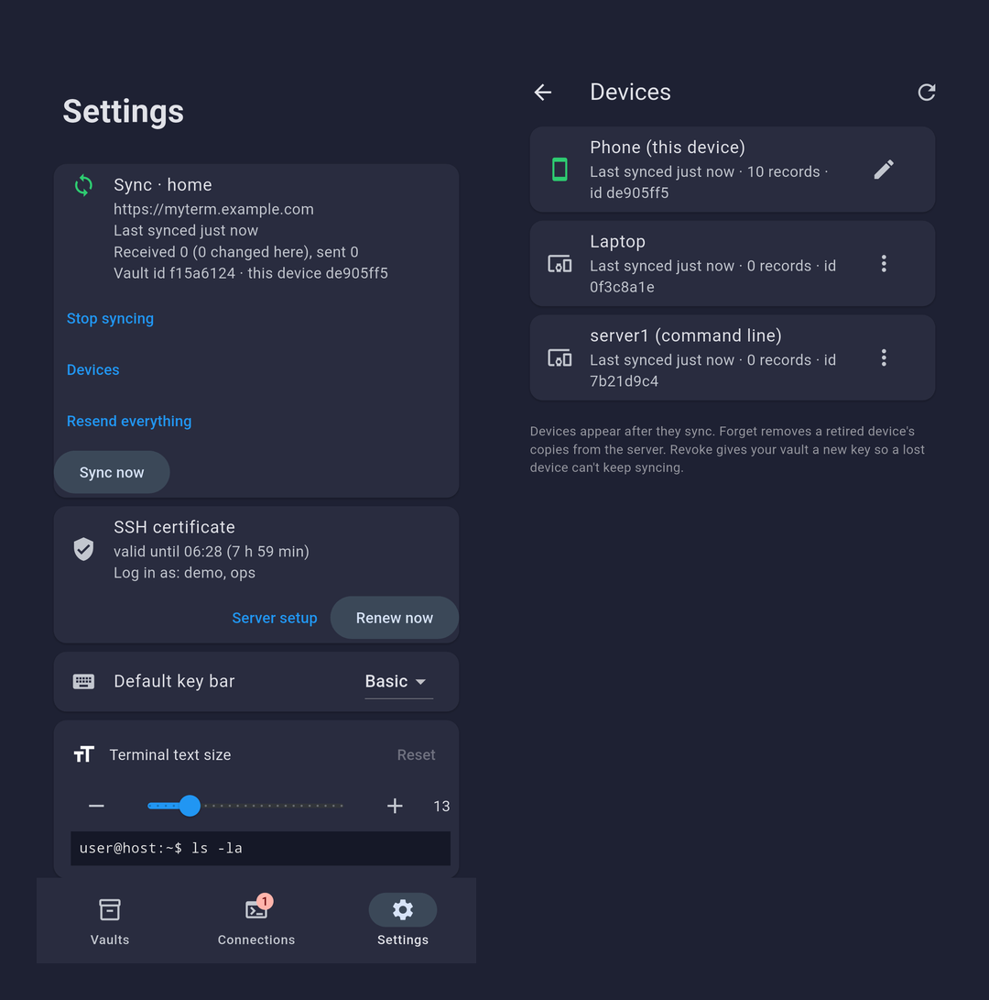
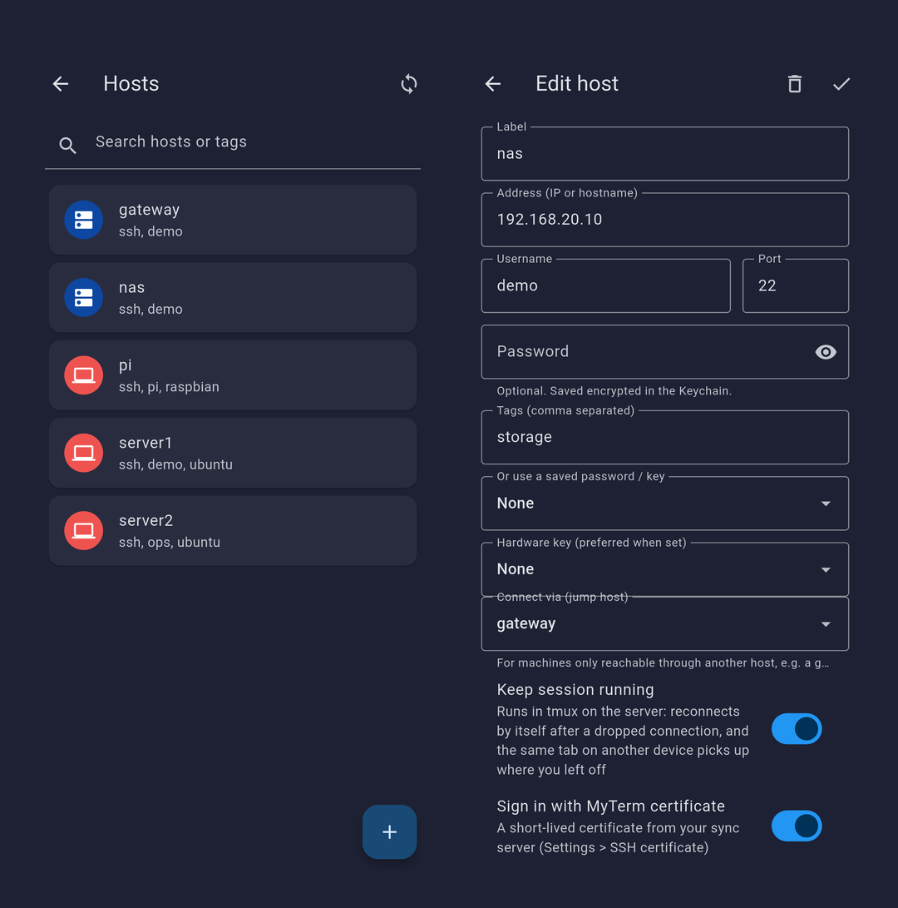
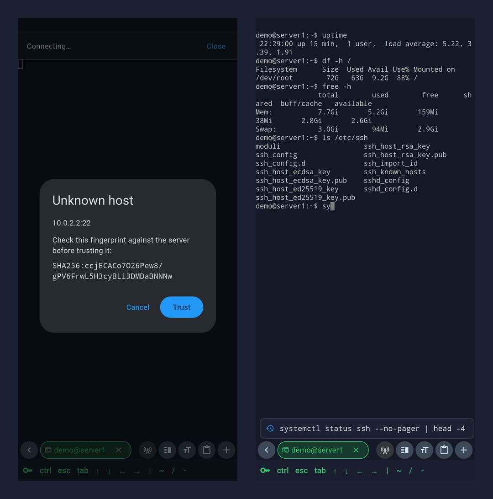
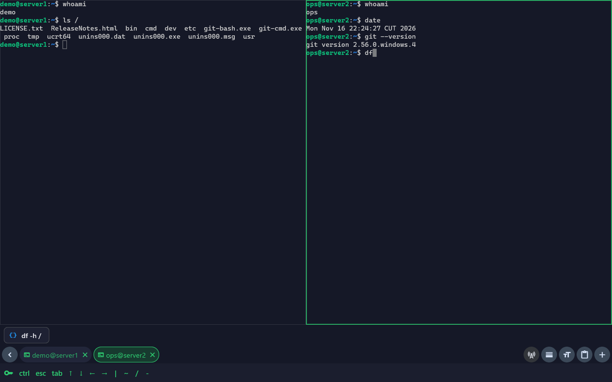
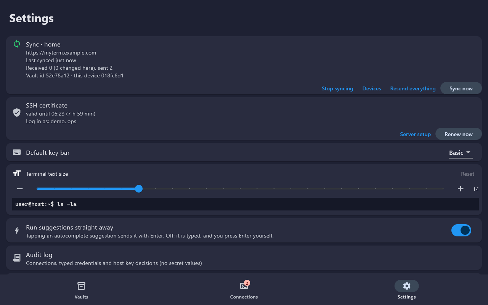
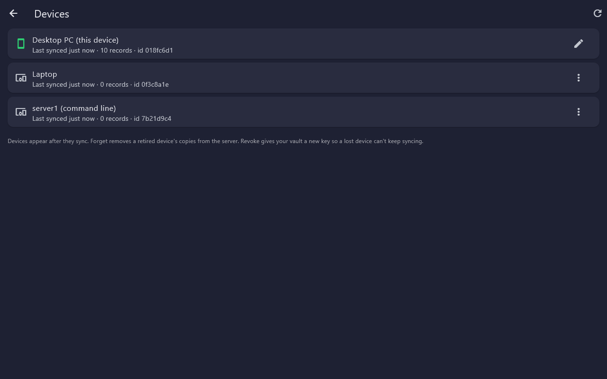

# MyTerm user guide

How to deploy MyTerm and use it day to day. (The editable copy of this guide
is a separate doc; this file is kept in step with it.)

- [Overview](#overview)
- [Deploy the sync server](#deploy-the-sync-server)
- [Install the apps](#install-the-apps)
- [First run: your vault](#first-run-your-vault)
- [Everyday use in the apps](#everyday-use-in-the-apps)
- [Everyday use on the Linux command line](#everyday-use-on-the-linux-command-line)
- [SSH certificates](#ssh-certificates)
- [Updating, devices and security](#updating-devices-and-security)
- [Troubleshooting](#troubleshooting)

## Overview

MyTerm is your SSH tool on the phone, the PC and any Linux shell, with the
same hosts, history and keys everywhere, kept in sync by your own server on a
Linux machine you run.



- **One vault, many devices.** Hosts, groups, jump hosts, snippets, command
  history and trusted host keys live in an encrypted vault on each device.
  Your master password unlocks it.
- **The sync server** on your server only ever sees encrypted copies. It also
  keeps the list of devices, and can issue short-lived SSH certificates.
- **Connections go straight** from the device to your servers (or through a
  jump host); nothing passes through the sync server.
- Releases are on this repository's Releases page; `upgrade.sh` and
  `deploy-apk.sh` on your server install and update everything.

## Deploy the sync server

The sync server runs in Docker on your server, behind your reverse proxy at
your own address (this guide writes it as `https://myterm.example.com`), and
is installed and updated by `upgrade.sh`.

**Once per server: the tools.** On a new Linux server, get `bootstrap.sh`
from the repo's `deploy` folder. The repository is private, so either copy it
from a server that already has it:

```
scp ~/.local/share/myterm-tools/deploy/bootstrap.sh NEWSERVER:
```

or download it with your read-only GitHub token (one line):

```
curl -fsSL -H "Authorization: Bearer YOUR_TOKEN" -H "Accept: application/vnd.github.raw" -o bootstrap.sh https://api.github.com/repos/OWNER/Myterm/contents/deploy/bootstrap.sh
```

Then, on the new server:

```
bash bootstrap.sh
```

It installs what's missing, makes a read-only GitHub deploy key (add it at
github.com/OWNER/Myterm → Settings → Deploy keys, write access off), links
`upgrade.sh` and `deploy-apk.sh` into `~/bin`, and stores the GitHub token
they use. After that, keep them current with:

```
upgrade.sh --self-update
```

**Install the server:**

```
upgrade.sh --add myterm-sync     # adds it to ~/.config/upgrade/apps.conf and installs it
upgrade.sh --list                # version, and whether anything newer is on GitHub
```

First install creates `~/docker_volumes/myterm-sync/server/.env` with a
random **server token** and a `data/` folder for the database. The container
listens on port 7341; point the reverse proxy at it.

**The server token** is needed once per device, when it joins (the apps'
Sync setup and `myterm join`):

```
grep MYTERM_SYNC_TOKEN ~/docker_volumes/myterm-sync/server/.env
```

**Settings in `server/.env`.** After changing any of them, apply them with:

```
upgrade.sh myterm-sync
```

| Setting | What it does |
| --- | --- |
| `MYTERM_SYNC_TOKEN` | Needed to create or find a vault. Long and random; made at first install |
| `MYTERM_SYNC_CERT_PRINCIPALS` | Turns on SSH certificates, for these login names, e.g. `youruser,root` |
| `MYTERM_SYNC_CERT_HOURS` | How long certificates last (default 8, 1 to 168) |
| `MYTERM_SYNC_TRUST_PROXY` | On in docker-compose: logs and rate limits use the proxy's `X-Forwarded-For` |

**Updates.** Each update backs up `.env` and `data/`, pulls the new version,
rebuilds, waits for the health check and tells you how to go back if anything
fails:

```
upgrade.sh                # everything that has an update
upgrade.sh myterm-sync    # just the sync server
```

**Backups.** Everything is in `~/docker_volumes/myterm-sync/server/data`: the
database (encrypted vaults only; the server can't read them) and, with
certificates on, the CA key `ssh_user_ca`. Keep the CA key private: it can
sign logins to servers that trust it.

**Without upgrade.sh**, from a copy of the repository:

```
cd Myterm/server
echo "MYTERM_SYNC_TOKEN=$(openssl rand -hex 24)" > .env
chmod 600 .env
mkdir -p data && sudo chown 10001:10001 data
docker compose up -d --build
curl http://localhost:7341/v1/health
```

Without a reverse proxy, comment out `MYTERM_SYNC_TRUST_PROXY` in
`docker-compose.yml`; behind one, publish the port on `127.0.0.1` only.

## Install the apps

Every release has all three: the Android APK, the signed Windows installer,
and the Linux command line.

**Android (phone, tablet, Fire TV).** From your server, with Wireless
debugging on the device (Developer options → Wireless debugging):

```
deploy-apk.sh myterm
```

Pick the device from the list it remembers (or a new one), give the ports
shown on the device's Wireless debugging screen, and it installs the newest
APK. Updates install over the old version; your vault is kept. You can also
copy `MyTerm-<version>.apk` to the device and open it.

**Windows.**

1. Once per PC, trust the MyTerm signing certificate: put `Trust-MyTerm.ps1`,
   `myterm-root.cer` and `myterm-codesign.cer` from the release in one folder
   with the installer, then run this in an administrator PowerShell in that
   folder:

   ```
   powershell -ExecutionPolicy Bypass -File .\Trust-MyTerm.ps1
   ```

2. Run `MyTerm-<version>-setup.exe`. It installs for your user only (no admin
   prompt), adds a Start menu entry, and later versions upgrade in place.
3. If Windows says "Windows protected your PC" for a file downloaded in the
   browser: right-click it → Properties → Unblock, or run the trust script,
   which unblocks installers in its folder.

No installer wanted? `MyTerm-<version>-windows-portable.zip` runs from any
folder.

**Linux command line (servers, a Raspberry Pi, a laptop).**

```
upgrade.sh --self-update
upgrade.sh --add myterm-cli     # downloads the build for this machine, checks its checksum, links ~/bin/myterm
```

It needs the read-only GitHub token that `deploy-apk.sh` uses (bootstrap.sh
asks for it).

Without upgrade.sh, unpack the release archive for your machine (`x86_64` or
`aarch64`) and copy the program to `~/bin`; shell completions are in the
archive's `completions` folder:

```
tar xzf myterm-<version>-linux-x86_64.tar.gz
cp myterm-<version>-linux-x86_64/myterm ~/bin/
```

## First run: your vault

One device creates the vault; every other device joins it with the same
master password, and then they sync through the server.

**The first device** (usually the phone): open MyTerm, choose a master
password (12 characters or more; it can't be recovered), then Settings → Sync
→ **Create vault**: your server address (such as
`https://myterm.example.com`), the server token and a vault name.



*Phone: first run (master password), then the Vault screen.*

**Every other device:**

- **App:** Settings → Sync → **Join existing vault**: server address, token,
  the same vault name and the master password. Anything already on the device
  is kept and merged in.
- **Linux:** run the command below and answer the questions. It also asks for
  a **scope**:

  ```
  myterm join
  ```

| Scope | The machine gets | Use for |
| --- | --- | --- |
| full | everything, stored passwords and keys included | your own laptop |
| certs | hosts, snippets, history, known hosts, an SSH certificate; no stored passwords or keys | servers |
| hosts | hosts, snippets, history, known hosts | shared machines |

No vault anywhere yet and starting on Linux? Create one with:

```
myterm join --create
```

**Check it worked.** Every device's Settings → Sync card shows a **vault
id**; they must all match (two different ids = two separate vaults, so nothing
syncs between them: on the odd one out, Stop syncing, then Join). On Linux,
this shows the same:

```
myterm status
```



*Phone: Settings → Sync shows the vault id; Devices lists everything in the vault.*

**Unlocking.** The apps unlock with biometrics or Windows Hello once set up,
or the master password. On Linux the master password unlocks for 15 minutes
of inactivity; to lock straight away:

```
myterm lock
```

## Everyday use in the apps

Add hosts once and they reach every device; open sessions in tabs; let
autocomplete and the key bar do the typing.

**Hosts** (Vault → Hosts, + to add):

- **Address, port (22 unless you change it), username**, and a **password**
  or a key. Saved credentials sync to devices with the full scope only.
- **Connect via (jump host):** for machines only reachable through another,
  e.g. a VLAN host through a gateway server. Jump hosts can chain.
- **Keep session running:** runs your shell in tmux on the server. If the
  connection drops, MyTerm reconnects by itself and you're back where you
  were; tab 1 on the phone and tab 1 on the PC are the same session.
- **Sign in with MyTerm certificate:** see [SSH certificates](#ssh-certificates).
- Pull down on the list to sync now; a banner shows if sync is off or failing.



*Phone: Hosts, and editing a host (long-press) that connects via a gateway,
keeps its session running and signs in with a certificate.*

**Sessions**

| What | How |
| --- | --- |
| Switch sessions | Tabs on the session bar; + opens another |
| Two at once | Split button: side by side → top and bottom → one. Tap a pane to type in it |
| Type in several at once | Tower button: tick the sessions; an amber banner shows it's on. Stored passwords are never broadcast |
| Autocomplete | Suggestions appear above the key bar from your history (shared across hosts and devices) and snippets, including combined `cd a/b`. Tap one to run it (Settings can make a tap only type it). With a keyboard: Tab / Shift+Tab to choose, Enter runs, Esc cancels |
| Type the stored password | The key button on the key bar, at a password prompt |
| Copy / paste | Select text then Copy; paste button. Windows: selecting copies, right-click pastes |
| Text size | Aa button, Settings, or Ctrl + = / - / 0 |



*Phone: the first connection asks you to check the host key. In the session,
typing `sy` offers a command from your history; below it are the session
tabs, the buttons (broadcast, split, text size, paste, new session) and the
key bar.*



*Windows: split view with two hosts side by side. The focused pane has the
green border; typing `df` there offers the Disk space snippet.*

**Key bar.** Basic by default (Settings → Default key bar); a host can have
its own.

**Trusting hosts.** The first connection shows the server's key fingerprint;
check it before trusting. MyTerm warns if a trusted key ever changes.

**Audit log** (Settings): connections, typed passwords, trusted keys and
syncs, kept across restarts and tamper-evident.

## Everyday use on the Linux command line

Type `myterm`, filter by a few letters, press Enter: the same hosts as the
apps, in your own terminal.

| Command | What it does |
| --- | --- |
| `myterm` | Host picker: type to filter, arrows, Enter connects, Esc quits |
| `myterm ssh server1` | Connect (jump hosts, certificates and saved logins as in the apps; asks for a password otherwise) |
| `myterm ssh server1 --tmux` | Keep the session in tmux and reattach after a drop (`myterm-1` = the apps' first tab) |
| `myterm ssh server1 -- uptime` | Run one command and print its output |
| `myterm run 'df -h /' -t homelab` | Run on every host tagged homelab at once; output grouped per host |
| `myterm multi server1 server2` | Hosts in tmux panes on this machine, with your typing sent to all |
| `myterm hosts [words] [--json]` | List hosts (JSON for scripts) |
| `myterm import` | Add hosts from `~/.ssh/config` (keys stay in `~/.ssh`) |
| `myterm set server1 --via gw --keep-session on --certificate on --tags homelab` | Change a host's options |
| `myterm cert`, `--renew`, `--trust` | This machine's certificate; `--trust` makes this machine's sshd accept MyTerm certificates |
| `myterm sync`, `status`, `devices`, `rename NAME` | Sync now, this machine's state, the vault's devices, this machine's name in the list |
| `myterm unlock`, `lock` | Unlock for 15 minutes of inactivity, or lock now |
| `myterm audit` | This machine's audit log (JSON lines) |

**Inside a session** the bottom line belongs to MyTerm: the host, then
autocomplete suggestions from your shared history as you type. Press
**Ctrl+]** then:

- **1–6** to run that suggestion
- **p** to type the host's stored password at a password prompt (**P** types
  it even if no prompt is seen)
- **.** to disconnect
- **]** to send Ctrl+] itself

## SSH certificates

With certificates on, each device signs in with its own key and an 8-hour
certificate from your sync server, so you never copy public keys to servers
and a lost device's access runs out by itself.

1. **Turn them on** (once): add these lines to
   `~/docker_volumes/myterm-sync/server/.env` on your server:

   ```
   MYTERM_SYNC_CERT_PRINCIPALS=youruser,root
   MYTERM_SYNC_CERT_HOURS=8
   ```

   then apply them:

   ```
   upgrade.sh myterm-sync
   ```

2. **Trust them on each server** (once per server). Either run this on that
   server:

   ```
   myterm cert --trust
   ```

   or use the commands from the app's Settings → SSH certificate → Server
   setup. Both put the CA key in `/etc/ssh/myterm_user_ca.pub`, add
   `TrustedUserCAKeys` to sshd, check the config and reload sshd.

3. **Use them per host:** turn on **Sign in with MyTerm certificate** in the
   host, or on Linux:

   ```
   myterm set HOST --certificate on
   ```

   Devices get and renew their certificate automatically when it has under 2
   hours left; Settings → SSH certificate shows until when it's valid.



*Windows: Settings → SSH certificate shows how long the certificate is valid
and the names it can log in as; Server setup has the commands for a server.*

The login names must be among `MYTERM_SYNC_CERT_PRINCIPALS`. The server's
auth log shows which device logged in (`myterm:<vault>:<device name>`).

## Updating, devices and security

**Updating everything after a release:**

| Part | Command or step |
| --- | --- |
| Scripts on a server | `upgrade.sh --self-update` |
| Sync server and the Linux command line | `upgrade.sh` (only what has something new) |
| Android | `deploy-apk.sh myterm` |
| Windows | Run the new `MyTerm-<version>-setup.exe` |

**Devices** (Settings → Sync → Devices) lists everything that syncs with your
vault. On Linux:

```
myterm devices
```



*Windows: Devices. The pencil renames this device; the menu on the others has
Forget and Revoke.*

- **Rename** this device so the list makes sense.
- **Forget** a device you've retired: its copies leave the server.
- **Revoke** a lost or stolen one: your vault gets a new key, optionally with
  a new master password; the old vault on the server is deleted. Your other
  devices then ask for the master password once to follow; the lost device
  can't without it. Set a new master password if whoever has it might know the
  old one.

**What protects what**

- The vault is encrypted on every device with a key from your master
  password; the sync server only ever holds encrypted copies.
- Unlock on the phone and PC with biometrics or Windows Hello; the key is
  protected by the Android Keystore or Windows DPAPI.
- Servers running the command line default to no stored passwords or keys
  (certs scope), so the most anyone could take there is a short-lived
  certificate.
- Hardware keys (Android Keystore) never leave the phone; see Vault → Hardware
  keys.

**Backups.** Your data is on every device and, encrypted, on the sync server.
Back up your server's `~/docker_volumes/myterm-sync/server/data` (upgrade.sh
also copies it before each update). Don't lose the master password: nothing
can recover it.

## Troubleshooting

**Hosts don't appear on another device.** Compare the **vault id** on each
device's Sync card, or on Linux:

```
myterm status
```

Different ids = different vaults: on the odd one out, Stop syncing, then Join
the right vault.

**"The server rejected this vault".** The vault was deleted or the server
reset: Stop syncing and set up sync again.

**"Your vault has a new key".** A device was revoked elsewhere: enter the
master password when asked (the new one, if it was changed).

**Sync shows nothing new after a server reset.** Settings → Sync → Resend
everything.

**"App not installed" on Android.** Only when the signing key differs (very
old test builds): uninstall once, then install.

**Windows: "Windows protected your PC".** Right-click the installer →
Properties → Unblock, or run Trust-MyTerm.ps1 in its folder.

**Certificate login refused.** Check three things: the login name is in
`MYTERM_SYNC_CERT_PRINCIPALS`; the certificate is valid (Settings → SSH
certificate); and the server trusts MyTerm certificates, which this sets up
when run on that server:

```
myterm cert --trust
```

**"SSH certificates aren't turned on".** Add `MYTERM_SYNC_CERT_PRINCIPALS` to
the server's `.env`, then:

```
upgrade.sh myterm-sync
```

**`upgrade.sh --add myterm-cli` can't download (error 401).** GitHub rejected
the token in `~/.config/apk/github.token`: it's missing, mistyped or expired.
Check it (200 = fine, 401 = bad token, 404 = no access to the repository):

```
curl -s -o /dev/null -w "%{http_code}\n" -H "Authorization: Bearer $(tr -d '[:space:]' < ~/.config/apk/github.token)" https://api.github.com/repos/OWNER/Myterm
```

Copy a working token from another server, or make a new read-only one
(Contents and Actions: read) and save it; `read` waits for you to paste it:

```
mkdir -p ~/.config/apk && read -rs T && printf '%s' "$T" > ~/.config/apk/github.token && chmod 600 ~/.config/apk/github.token
```

**`myterm` keeps asking for the master password.** Check the unlock state:

```
myterm status
```

`MYTERM_UNLOCK_MINUTES` sets how long it stays unlocked (0 = never).

**A host's key changed warning.** Expected only after reinstalling that
server. Otherwise don't connect: it may not be your server.

**Session drops on mobile data.** Turn on Keep session running for the host
(needs tmux on the server).

## Screenshots

The pictures come from the real apps with a demo vault, made by the
Screenshots workflow (`.github/workflows/screenshots.yml`). To refresh them
after UI changes, run it, then rebuild the images from the
`guide-screenshots` branch with `docs/images/compose.py`.
